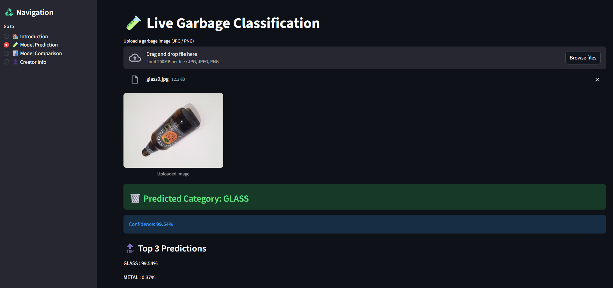

# ♻️ Garbage Image Classification Using Deep Learning

An end-to-end Deep Learning project that classifies garbage images into different waste categories using **Transfer Learning** and deploys the best-performing model through a **Streamlit web application**.

---

## 📌 Project Overview

Improper waste segregation is a major challenge in waste management systems.  
This project aims to automate garbage classification using Convolutional Neural Networks (CNNs) and Transfer Learning models such as **MobileNetV2**, **EfficientNetB0**, and **ResNet50**.

After evaluating multiple models, **ResNet50** was selected for deployment due to its superior accuracy and generalization performance.

---

## 🧠 Models Used

- MobileNetV2  
- EfficientNetB0  
- ResNet50 ✅ *(Best Model)*  

All models were trained using **ImageNet pre-trained weights** and fine-tuned on a garbage classification dataset.

---

## 📊 Results Summary

| Model | Validation Accuracy |
|------|---------------------|
| MobileNetV2 | ~75–78% |
| EfficientNetB0 | ~92% |
| **ResNet50** | **~96%** ✅ |

ResNet50 demonstrated:
- Better feature extraction
- Lower validation loss
- Higher generalization capability

---

## 🖥️ Streamlit Application

The project includes a **multi-page Streamlit application** that allows users to:

- Upload a garbage image
- Predict the waste category
- View prediction confidence
- Compare multiple models
- Understand why ResNet50 was chosen

### 🔍 Sample Prediction (Streamlit App)



> The application predicts the garbage category in real-time using the trained ResNet50 model.

---

## 📁 Project Structure

```text
Garbage-Image-Classification/
│
├── notebooks/
│   ├── MobileNetV2.ipynb
│   ├── EffiNetBO.ipynb #EfficientNetB0.ipynb
│   └── myResnet50  #ResNet50.ipynb
│
├── streamlit_app/
│   ├── app.py
│ 
├── assets/
│   └── prediction.png
│
├── documentation/
│   └── Garbage_Classification_Project_Documentation.docx
│
├── requirements.txt
├── README.md
└── .gitignore
```
### 📦 Dataset

- Source: Kaggle
- Dataset: Garbage Classification Dataset
- Link: https://www.kaggle.com/datasets/asdasdasasdas/garbage-classification/data

⚠️ The dataset is not included in this repository due to GitHub size limitations.  

---

### 🚀 How to Run the Project
- 1️⃣ Install Dependencies
- pip install -r requirements.txt
- 2️⃣ Run Streamlit App
- streamlit run streamlit_app/app.py

---

### 🧪 Evaluation Metrics
- Accuracy
- Precision
- Recall
- F1-Score
- Confusion Matrix
The final deployed model achieves high accuracy with balanced class-wise performance.

---

### 🛠️ Technologies Used
- Python
- TensorFlow / Keras
- Convolutional Neural Networks (CNN)
- Transfer Learning
- Streamlit
- Computer Vision

---

### 🔮 Future Enhancements
- Real-time camera-based garbage detection
- Mobile application deployment
- Integration with smart waste management systems

---

👨‍💻 Author
Atharva Borawake
